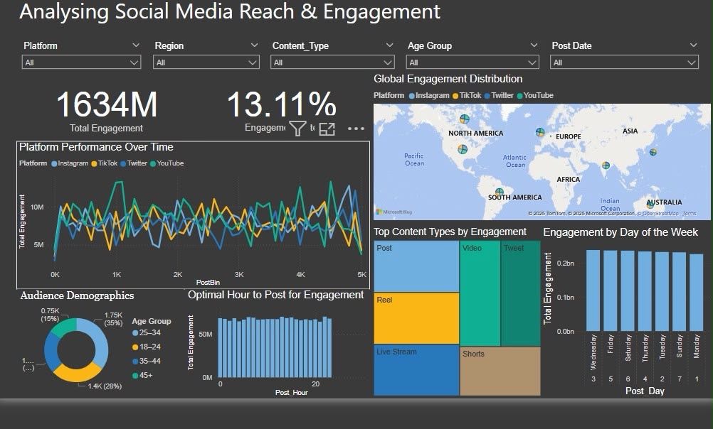

# 📊 Social Media Reach & Engagement Analysis

### Interactive Power BI Dashboard | Social Media Analytics

## 📌 Project Overview

This project focuses on analysing social media engagement patterns across multiple platforms using **Microsoft Power BI**.

The dashboard provides an overview of platform performance, audience demographics, geographical engagement distribution, content effectiveness, and posting trends.

The objective is to explore how engagement varies across social media platforms and identify patterns that could inform data-driven content strategies.

## 🎯 Project Objectives

- Analyse overall social media engagement and engagement rates.
- Compare engagement performance across Instagram, TikTok, Twitter, and YouTube.
- Explore audience demographics across different age groups.
- Visualise geographical engagement distribution.
- Compare the performance of different content formats.
- Examine engagement trends by posting hour and day of the week.
- Develop an interactive dashboard for exploring social media performance.

## 🛠️ Tools & Technologies

- **Microsoft Power BI** — Dashboard development and data visualisation
- **Data Analytics** — Exploratory analysis of social media performance
- **KPI Reporting** — Engagement metrics and performance tracking
- **Interactive Visualisation** — Filters, charts, geographical maps, and comparative analysis

## 📈 Dashboard Preview

## 🔍 Dashboard Features

### 1. Engagement KPI Overview

The dashboard presents two headline metrics:

- **Total Engagement:** 1,634M
- **Engagement Rate:** 13.11%

These measures provide a high-level overview of the engagement represented in the dashboard.

### 2. Platform Performance Analysis

A line chart compares engagement across four platforms:

- Instagram
- TikTok
- Twitter
- YouTube

This visualisation enables comparisons of engagement patterns across the platforms represented in the dataset.

### 3. Global Engagement Distribution

An interactive map illustrates geographical engagement distribution, supporting comparisons across global regions.

### 4. Audience Demographics

A doughnut chart displays audience distribution across four age groups:

- Under 18
- 18–24
- 25–44
- 45+

This helps explore the composition of the audience represented in the data.

### 5. Content Type Performance

A treemap compares engagement across different content formats, including:

- Posts
- Videos
- Tweets
- Reels
- Live streams
- Shorts

### 6. Posting Time Analysis

The dashboard includes visualisations for:

- Engagement by hour of the day
- Engagement by day of the week

These charts allow users to explore patterns in engagement across different publishing times.

### 7. Interactive Filters

Users can explore the dashboard using filters for:

- Platform
- Region
- Content type
- Age group
- Post date

## 💡 Analytical Value

The dashboard brings multiple engagement indicators together in a single reporting view.

It demonstrates how social media data can be used to explore:

- Platform-level engagement differences
- Audience composition
- Content format performance
- Geographical engagement patterns
- Temporal patterns in user engagement

These analyses can support further investigation into content strategy and audience engagement.

## 🚀 Skills Demonstrated

- Power BI dashboard development
- Exploratory data analysis
- KPI visualisation
- Data storytelling
- Audience segmentation
- Social media performance analysis
- Interactive dashboard design
- Business intelligence reporting

## 📂 Repository Contents

| File | Description |
|---|---|
| `README.md` | Project documentation and dashboard overview |
| `social-media-dashboard.jpg` | Screenshot of the completed Power BI dashboard |

## 📝 Project Availability

This repository currently contains a screenshot-based portfolio showcase of the completed Power BI dashboard.

The original Power BI `.pbix` file and underlying dataset are not currently included.

---

**Project Type:** Data Analytics & Business Intelligence  
**Primary Tool:** Microsoft Power BI  
**Focus:** Social Media Reach & Engagement Analysis
